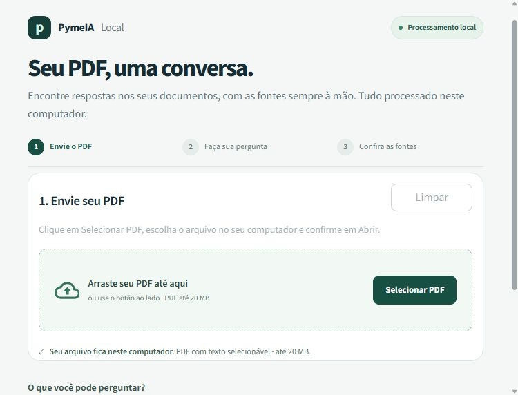
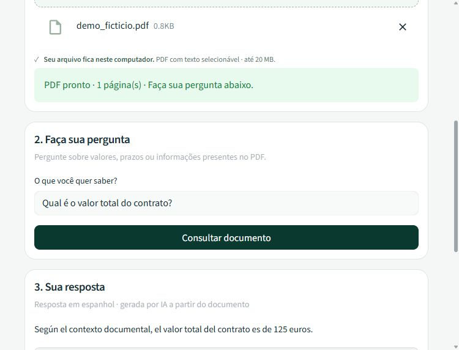

# 🔒 PymeIA Local


Asistente documental RAG para PYMES y gestorías españolas. Inferencia y embeddings locales, referencias a las páginas y almacenamiento vectorial efímero. Proyecto de portfolio, sin certificación jurídica.

## 🎯 El Problema

Las PYMES y gestorías manejan facturas, contratos y datos de plantilla. Enviar estos documentos a servicios de IA en la nube introduce terceros, posibles transferencias internacionales, obligaciones contractuales y costes recurrentes. No constituye automáticamente una infracción del RGPD, pero requiere una evaluación y garantías adecuadas.

## 💡 La Solución

PymeIA Local permite cargar un PDF y consultar su contenido sin enviar documentos ni preguntas a proveedores externos. Ollama ejecuta `llama3` y `nomic-embed-text` en el propio equipo. No hay coste por llamada a una API; sí existen costes de hardware y electricidad.

El PDF se lee con PyPDFLoader, se divide en fragmentos de 1.000 caracteres con solapamiento de 200 y se indexa en Chroma en memoria. Para cada pregunta se recuperan hasta cuatro fragmentos, se pasan al modelo y se muestran como fuentes. Las respuestas están en español; la interfaz, en portugués.

## ⚙️ Stack Tecnológico

- 🐍 Python 3.10 o superior; se recomienda 3.11 para estas dependencias fijadas.
- 🖥️ Streamlit: interfaz y estado por sesión.
- 🔗 LangChain: carga, segmentación, recuperación y cadena de respuesta.
- 🦙 Ollama y ChatOllama: `llama3`, temperatura 0,1.
- 🧩 OllamaEmbeddings: `nomic-embed-text`.
- 🗂️ ChromaDB: colección efímera independiente por sesión.
- 📄 PyPDF: extracción de texto del PDF.

Las dependencias directas tienen versiones fijadas. También se incluye `requirements.lock.txt`, con 122 paquetes resueltos para Python 3.11. Para reproducir ese perfil, instala con `python -m pip install -r requirements.lock.txt`. La resolución de dependencias no equivale a una prueba de ejecución ni a una auditoría de seguridad.

## 🚀 Cómo ejecutar

### 1. Instalar Ollama y los modelos

Instala [Ollama](https://ollama.com/download). Abre la aplicación o inicia el servicio con `ollama serve` si todavía no está activo. En otra terminal:

```bash
ollama pull llama3
ollama pull nomic-embed-text
ollama list
```

La instalación y la descarga de modelos necesitan internet. Una vez disponibles las dependencias y los modelos, las consultas pueden realizarse sin conexión. Reserva varios GB para los modelos; el rendimiento y la memoria necesarios dependen del equipo y del tamaño del documento.

El código conecta exclusivamente con `http://127.0.0.1:11434` y desactiva proxies de entorno para esos clientes. No expongas Ollama a internet.

### 2. Crear el entorno

Desde la carpeta `pyme-ia-local`:

```bash
python -m venv .venv
```

Windows PowerShell:

```powershell
.\.venv\Scripts\Activate.ps1
```

GNU/Linux o macOS:

```bash
source .venv/bin/activate
```

Instala las dependencias:

```bash
python -m pip install -r requirements.txt
python -m pip check
```

No se necesitan claves ni variables de entorno. `.env.example` está vacío y la aplicación no carga archivos `.env`.

### 3. Iniciar la aplicación

Ejecuta desde esta carpeta para aplicar `.streamlit/config.toml`:

```bash
streamlit run app.py
```

Abre `http://127.0.0.1:8501`. Carga un PDF con texto seleccionable, formula una pregunta y revisa las páginas indicadas en las fuentes. El límite es de 20 MB por PDF. Para digitalizaciones, realiza OCR local previamente; no hay OCR integrado.

### 4. Comprobación manual

1. Crea un PDF de prueba sin datos personales con una frase inequívoca, por ejemplo: «El importe del contrato es de 125 euros».
2. Pregunta por el importe y comprueba la respuesta y su fragmento fuente.
3. Pregunta por información ausente: la respuesta esperada es «No tengo esa información en el documento proporcionado.» El modelo puede incumplir el prompt; la revisión humana sigue siendo necesaria.
4. Cambia de PDF y comprueba que se elimina el índice anterior. En otra sesión del navegador, verifica que no aparece el documento de la primera.
5. Pulsa el botón para borrar documento y respuestas.
6. Detén Ollama y comprueba que aparecen instrucciones para iniciarlo y descargar los modelos.
7. Con los modelos ya instalados, desconecta internet y repite una consulta.

## 🔒 Cumplimiento RGPD y Ley de IA de la UE

### Medidas técnicas implementadas

- Documentos, preguntas, embeddings y respuestas se procesan en el equipo; el código de consulta no utiliza APIs de IA externas.
- El servicio web escucha en loopback y tiene protección XSRF habilitada.
- Telemetría de Streamlit y Chroma y trazas de LangChain/LangSmith desactivadas.
- Los PDF temporales se eliminan con `os.unlink()` en un bloque `finally` inmediatamente después de extraer el texto, también si falla la lectura.
- Los vectores no se persisten. Cada sesión utiliza una colección con identificador aleatorio; documentos y resultados no se guardan en la caché global de Streamlit.
- El cambio de documento y el botón de borrado eliminan la colección activa. No se registran contenidos ni excepciones sensibles en consola.
- Respuestas y fragmentos se presentan como texto simple, evitando imágenes remotas incrustadas por el modelo o el documento.

Estos controles apoyan la privacidad por diseño; **no garantizan conformidad total ni son una certificación «RGPD Compliant»**. La organización debe justificar la base jurídica, limitar las finalidades, informar a las personas, atender derechos, controlar accesos y plazos, y evaluar si procede una EIPD.

El uso de IA está identificado en la interfaz. Las obligaciones de la Ley de IA dependen de la finalidad y del papel de la organización. Este prototipo no está diseñado para decisiones automatizadas sobre empleo, crédito, salud o derechos. Los usos en asesorías, clínicas o RR. HH. requieren evaluación jurídica y técnica específica antes de tratar datos reales.

Fuentes oficiales: [principios del RGPD, Comisión Europea](https://commission.europa.eu/law/law-topic/data-protection/information-business-and-organisations/principles-gdpr_en), [RGPD e inteligencia artificial, AEPD](https://www.aepd.es/guides/gdpr-compliance-processings-that-embed-ia.pdf) y [marco de la Ley de IA](https://digital-strategy.ec.europa.eu/en/policies/regulatory-framework-ai).

### Alcance y límites de privacidad

La configuración cubre esta aplicación, no todos los procesos del sistema operativo. El borrado de un archivo no equivale a borrado seguro: pueden existir copias, paginación, volcados o respaldos. Un cierre abrupto durante la lectura puede dejar un temporal. Streamlit conserva el archivo cargado en memoria mientras el widget lo mantenga y Ollama puede mantener modelos o buffers residentes.

Cerrar una pestaña no garantiza limpieza inmediata de las colecciones; utiliza el botón de borrado y termina el proceso para liberar el estado restante. La memoria del proceso y Chroma son compartidos por la aplicación, aunque la recuperación usa colecciones separadas. No hay autenticación ni aislamiento de procesos entre usuarios. Es una herramienta personal local, no un servicio multiusuario listo para producción.

El prompt limita las respuestas al contexto y pide ignorar instrucciones maliciosas del PDF; no elimina las alucinaciones ni garantiza resistencia a inyección de instrucciones. Revisa siempre las fuentes. La recuperación semántica puede omitir fragmentos relevantes y no sustituye una revisión documental completa.

Los badges del README se sirven desde un tercero al visualizar esta documentación; no forman parte del flujo de consulta de la aplicación. Para probar el funcionamiento sin red, ejecuta la interfaz local con todos los modelos previamente descargados.

## 📸 Captura de pantalla



Interfaz con carga de PDF en la pantalla principal, botón «Selecionar PDF» y guía en tres pasos. Después de cargar el documento aparece el campo de pregunta; las fuentes se muestran abiertas junto a la respuesta. Las capturas son reales y utilizan únicamente un PDF ficticio.



## 👤 Autor

**Waly Robert**  
LinkedIn: pendiente de añadir.  
GitHub: [WalyRobert](https://github.com/WalyRobert)

## Verificación incluida

Ejecuta `python -m unittest discover -p test_privacy.py -v` desde esta carpeta. Las dos pruebas aisladas verifican el borrado del temporal después de una lectura correcta y de una excepción simulada. No requieren modelos ni conexión. La integración real con los dos modelos y la interfaz se validaron el 10 de noviembre de 2026. Los resultados y sus límites figuran en `tests/RESULTADOS.md`.


Para repetir las pruebas con Ollama en ejecución y ambos modelos instalados:

```bash
python tests/integration_ollama.py
python tests/ui_smoke.py
```


